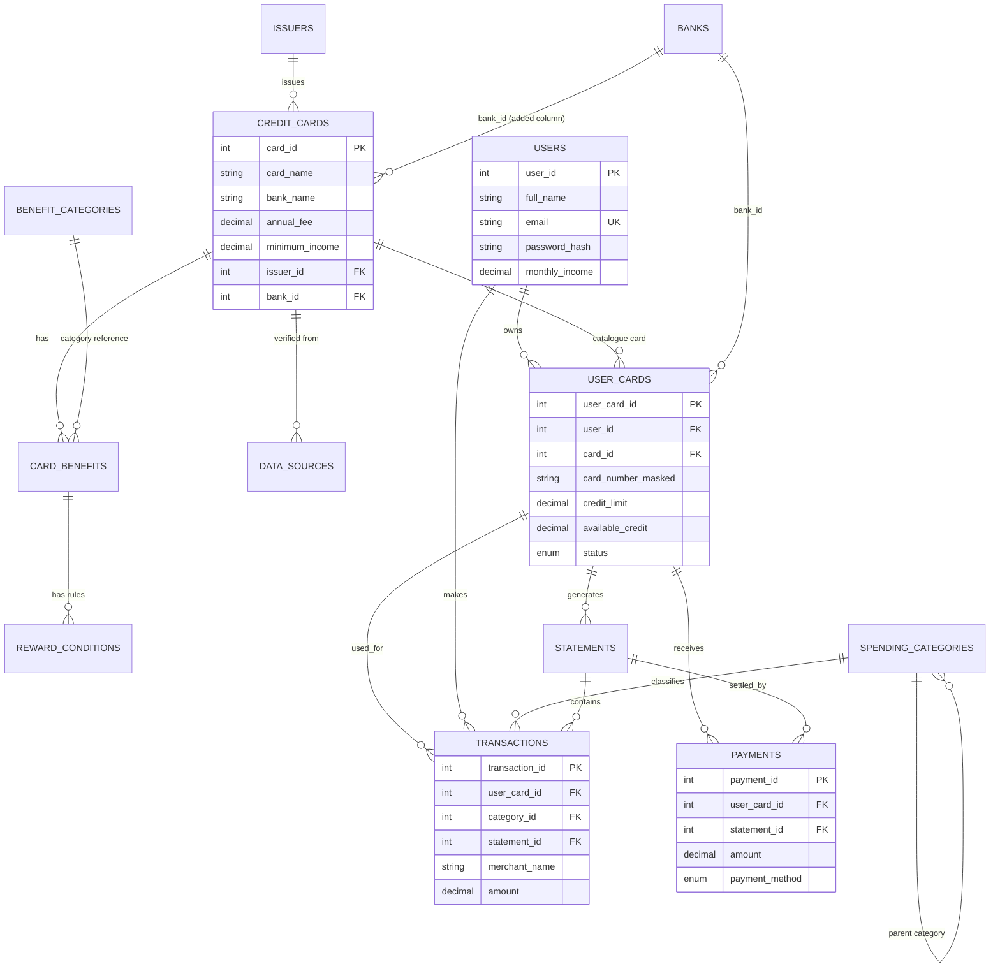

# Database Design

## 1. ER diagram



---

## 2. Table catalogue

### Existing catalogue tables (preserved)

| Table | Purpose |
| --- | --- |
| `issuers` | Original card issuer master data. |
| `credit_cards` | Original card catalogue. New optional `bank_id` links it to `banks`. |
| `card_benefits` | Cashback/reward benefits. New optional `point_value` converts points to rupees. |
| `reward_conditions` | Caps, minimum spend, exclusion merchants and textual spending conditions. |
| `data_sources` | Source URLs and verification dates for catalogue data. |

### New application tables

| Table | Purpose |
| --- | --- |
| `banks` | Normalized bank master; avoids repeating full bank names in every application row. |
| `users` | Login, profile, income and credit score. |
| `spending_categories` | Self-referencing category hierarchy for transactions. |
| `benefit_categories` | Controlled vocabulary for verified benefits. |
| `user_cards` | A user's physical card instance, masked number, limit and available credit. |
| `statements` | One row per card per billing month. |
| `transactions` | Spend events linked to user card, category and optional statement. |
| `payments` | Payments made toward a card/statement. |

### Views

| View | Use |
| --- | --- |
| `v_user_card_summary` | Card limit, used credit and utilization. |
| `v_monthly_spending` | `GROUP BY` month and category with `COUNT`, `SUM`, `AVG`, `MAX`, `MIN`. |
| `v_upcoming_payments` | Outstanding statements and days until due. |
| `v_verified_benefits` | Only active cards with verified benefits and their rules. |

---

## 3. Normalization

The schema follows 3NF:

- Every table has a single subject (`users`, `payments`, `transactions`, etc.).
- Non-key attributes depend on the key, the whole key and nothing but the key:
  - `payments.amount` depends on `payment_id`, not on `payment_method`.
  - `transactions.amount` depends on `transaction_id`, not on `merchant_name`.
- Repeating groups are removed:
  - One card can have many benefits in `card_benefits`, not multiple columns like `benefit1`, `benefit2`.
  - One user can have many cards in `user_cards`.
- Repeated bank names are represented by `banks.bank_name` and linked with `bank_id`.
- Derived values such as `used_credit` and `utilization_pct` are computed in views instead of stored.

---

## 4. Keys, constraints and indexes

### Keys

- Primary keys on every table.
- Foreign keys link parent and child rows with explicit `ON DELETE` behavior:
  - `CASCADE` for owned child data (benefits, statements, user cards).
  - `RESTRICT` for accounting history (transactions, payments referencing a card).
  - `SET NULL` for optional references (issuer, bank, statement).
- Unique keys prevent duplicates:
  - `uq_users_email`
  - `uq_user_card_number`
  - `uq_statement_period`
  - `uq_payment_reference`
  - `uq_bank_name`
  - `uq_spending_category_name`

### CHECK constraints

- `chk_transaction_amount`: amount must be positive.
- `chk_payment_amount`: amount must be positive.
- `chk_user_card_credit`: `0 <= available_credit <= credit_limit`.
- `chk_user_card_days`: billing day `1..28`, due day `1..31`.
- `chk_statement_amounts`: statement totals are non-negative.

### Indexes

Indexes speed up the dashboard and filters:

- `idx_transactions_user_date`, `idx_transactions_card_date`, `idx_transactions_category`
- `idx_payments_card_date`, `idx_payments_statement`
- `idx_statements_due`
- `idx_benefits_card`, `idx_benefits_category`
- `idx_user_cards_user`, `idx_user_cards_card`

---

## 5. Transaction handling

Money-changing operations in `backend/routes/transactions.py` and `backend/routes/payments.py` follow this pattern:

1. `START TRANSACTION`
2. `SELECT ... FOR UPDATE` locks the affected `user_cards` row.
3. Validate that available credit is sufficient.
4. `UPDATE user_cards SET available_credit = ...`
5. `UPDATE statements SET total_due / amount_paid / status = ...`
6. `COMMIT` on success, `ROLLBACK` on any error.

Example: adding a transaction decreases available credit and increases the current statement total. If any step fails, no partial change is kept.

---

## 6. Important SQL patterns used

```sql
-- JOIN + GROUP BY + aggregate
SELECT c.category_name, SUM(t.amount) AS total, COUNT(*) AS txns
FROM transactions t
JOIN spending_categories c ON c.category_id = t.category_id
WHERE t.user_id = 1
GROUP BY c.category_name
ORDER BY total DESC;

-- Subquery to find a user's highest spend category
SELECT category_name, total_spent
FROM v_monthly_spending
WHERE user_id = 1
  AND spend_month = DATE_FORMAT(CURDATE(), '%Y-%m')
ORDER BY total_spent DESC
LIMIT 1;

-- HAVING filters grouped results
SELECT user_card_id, SUM(amount) AS spent
FROM transactions
GROUP BY user_card_id
HAVING SUM(amount) > 10000
ORDER BY spent DESC;

-- Nested subquery: cards with more verified benefits than average
SELECT card_id, card_name
FROM credit_cards c
WHERE (
    SELECT COUNT(*)
    FROM card_benefits b
    WHERE b.card_id = c.card_id AND LOWER(b.benefit_status) = 'verified'
) > (
    SELECT AVG(benefit_count)
    FROM (
        SELECT COUNT(*) AS benefit_count
        FROM card_benefits GROUP BY card_id
    ) x
);
```

More runnable examples are in `sql/demo_queries.sql`.

---

## 7. Safe migration behavior

`python -m backend.migrate --init-db`:

1. Creates the database if needed.
2. Runs `sql/schema.sql` with `CREATE TABLE IF NOT EXISTS`.
3. Adds `card_benefits.point_value` and `credit_cards.bank_id` only if missing.
4. Back-fills `credit_cards.bank_id` from `banks` where names match.
5. Runs `sql/seed.sql`, which uses `INSERT ... SELECT ... WHERE NOT EXISTS`.

It never drops existing tables or deletes existing card rows.
